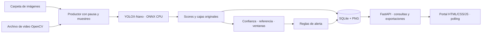

# Arquitectura y manual de ejecución

La referencia de cierre es el [informe final](ENTREGA_FINAL.md). Se conserva la
arquitectura de inferencia y se añade una capa humana independiente.

## Revisión humana e integridad

`reviews.py` proyecta IDs individuales estables a partir de evento+índice sin editar
las listas históricas. SQLite añade `detection_reviews` con clave única de petición
y versión por detección. `BEGIN IMMEDIATE` serializa guardados; una versión vieja
produce 409 y un reintento idéntico devuelve la misma revisión. El historial es
append-only, con actor local, motivo, fecha, clase original, corregida opcional y hash.

La vista original conserva cajas/scores/zonas. La revisada dibuja solo confirmadas o
corregidas y etiqueta explícitamente la capa humana; no genera nuevas predicciones.
Sin imagen íntegra se bloquea guardar una validación visual. Un IoU >=0.5 solo avisa
de cajas superpuestas; no suprime ni cambia NMS. El registro original nunca se actualiza.

La gestión de alertas conserva su tabla original y añade motivo/review_ids al historial
de cambios. Las revisiones deben pertenecer a eventos de esa alerta y corresponder
al motivo. La condición automática histórica y la decisión humana son campos distintos.
Las consultas de alertas cargan historiales en un lote, evitando una conexión SQLite
por cada alerta. La galería conserva SQL paginado, derivados en caché y control de
concurrencia del cliente. Nuevos runs de colecciones usan rutas relativas a la raíz;
las fuentes históricas y sus configuraciones originales no se reescriben.

## Flujo de inferencia conservado

El [README](README.md) contiene los comandos exactos de instalación, servidor, escenarios
y pruebas en PowerShell. El [manual de usuario](MANUAL_USUARIO.md) describe los recorridos.

## Módulos y responsabilidades

| Módulo | Responsabilidad |
| --- | --- |
| config | Pydantic, overrides, huella de valores efectivos, raíces permitidas. |
| camera | Secuencias y video secuencial, recepción/posición, errores y contabilidad. Conserva adaptador legado no requerido. |
| sources | Registro de fuentes, validación, SHA de archivo/manifiesto e IDs únicos. |
| detector / _yolox | Modelo verificado, inferencia real, letterbox, rejilla, NMS y scores sin sustitución. |
| service | Productor único, exclusión mutua para pausa, publicación tras persistencia y métricas primarias. |
| confidence / alerts | Zonas, referencia fija, ventanas no solapadas, mínimos y reglas independientes. |
| database | Conexiones cortas, transacciones, índices y migración aditiva a esquema 2. |
| query | Predicado compartido para filtros, orden y paginación. |
| images | Resolución segura, originales inmutables y PNG anotado del evento solicitado. |
| metrics / analytics / distribution | Bases G1–G7, extras, históricos y distancia entre CDF comparables. |
| exporting | CSV con neutralización de fórmulas y estructura de observaciones. |
| application / main | Rutas HTML/API y fábrica compatible con Uvicorn. |

## Contratos e invariantes

- Un evento referencia run, frame, fuente, modelo SHA, configuración completa/hash y
  estado. El array de detecciones conserva clase, bbox y confianza después de NMS.
  Las candidatas previas al NMS se guardan aparte; G4 usa detecciones finales.
- Se conserva el PNG decodificado y su hash sin pérdida; el hash del archivo/paquete
  recibido también se registra. La anotación deriva de un ID inmutable y nunca se
  sobrescribe sobre la captura original.
- Solo se publica latest_event después de guardar evento/alertas/ventana. La respuesta
  de reproducción enlaza imagen y anotación con ese mismo ID. La UI espera la imagen
  del snapshot antes de cambiar metadatos y no usa detecciones del frame anterior.
- Pause adquiere el bloqueo de procesamiento: al responder no quedan inferencias en
  vuelo. Resume conserva run/configuración/referencia. La espera entre muestras queda
  fuera del bloqueo. Tiempos monotónicos evitan restar relojes de pared en G1/G2.
- El video mantiene lectura secuencial; frames descartados son lecturas no inferidas,
  no frames fabricados. Se conserva una muestra terminal para contabilizar el final.
- SQLite persiste fuentes, acciones y cambios de alerta junto con los datos base.
  Los cambios usan BEGIN IMMEDIATE, versión esperada e ID idempotente. La alerta
  original conserva su payload; su estado actual se reconstruye desde cambios append-only.
- Las consultas actuales enriquecen alertas con historial; los snapshots anteriores
  se recalculan usando solo cambios anteriores al corte. Reconocida cuenta como abierta
  hasta resolución. Ninguna revisión modifica una salida del detector.
- Los registros de fuentes solo admiten medios dentro de raíces configuradas. resolve
  comprueba escapes por enlaces; se revalida al iniciar. Las URLs de imagen reciben
  IDs de eventos, no rutas proporcionadas por el cliente. Los ZIP usan nombres seguros.
- Las series base están segmentadas por ejecución y configuración. La comparación de
  distribuciones exige referencia/ventana completas del mismo modelo/hash y configuración.

## Reproducción y evidencia

`run_scenarios.py` genera una carpeta nueva por batería. Cada escenario conserva
configuración, entorno, hashes de código, entradas decodificadas, eventos, ventanas,
alertas, métricas y recálculos. S1 interrumpe archivos creados por esa batería, sin
tocar datos anteriores. S7 identifica el fallo inyectado y cada éxito real posterior.

`verify_metrics.py` recalcula bases con corte fijo; `verify_extras.py` reconstruye extras;
`verify_features.py` contrasta endpoints y descarga contra observaciones. Los tests
unitarios con dobles llevan synthetic=true; no acreditan por sí mismos inferencia real.

Limitaciones explícitas: consultas de JSON en Python y anotaciones bajo demanda para
un servicio local, no probado bajo carga prolongada; posición nominal en video VFR;
retención sin TTL puede aumentar uso de disco. No se requiere nube ni se simula cámara.

## Extensión de datasets y galería · 0.3

datasets.py adquiere fotografías seleccionadas desde HTTPS oficial y valida licencia,
SHA y similitud perceptual. El manifiesto se transforma en ocho fuentes mediante
sync_collections al iniciar la factoría normal. El productor añade input_image y
verifica SHA antes de inferir. source_id/collection/run_id separan origen previsto
y salidas reales. No hay descarga de dataset durante una petición del portal.
SQLite v3 agrega índices de fuente/colección y image_assets, un inventario derivado
reconstruible; no actualiza payloads históricos. Los filtros de detección se aplican
en un mismo EXISTS de json_each y LIMIT/OFFSET preceden a la materialización de la página.
Conteos/página usan una transacción de lectura común. Gallery hace stat ligero por
consulta y vuelve a hashear/validar solo si cambia firma; G5 conserva su comprobación
de bytes. Las alertas de la página se resuelven en una consulta de lote.
La vista carga JPEG 320x240 con ETag, observación de visibilidad, cuatro descargas,
abort por cambio de consulta/documento y timeout/reintento. Al iniciar un nuevo run,
se limpia el frame anterior y se rechazan snapshots de otro run. El polling de 1 s
puede retrasar la publicación visual; nunca superpone cajas de otro evento.
